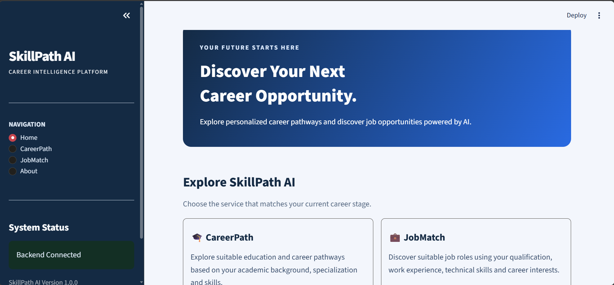
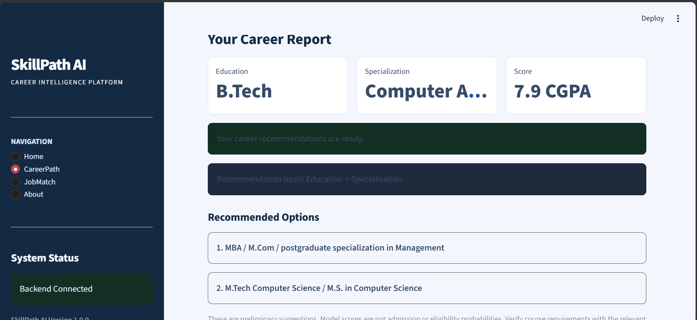
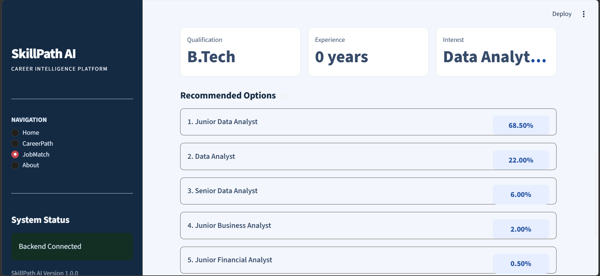
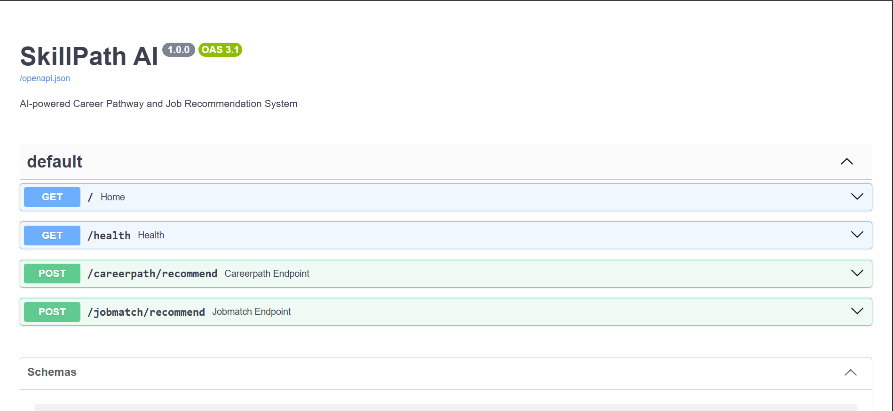

# SkillPath AI – Career Pathway & Job Recommendation System

An AI-powered career intelligence platform that helps students explore suitable educational pathways and helps candidates discover relevant job opportunities based on their qualifications, skills, experience, and interests.

## Project Overview

SkillPath AI is divided into two intelligent modules:

### 1. CareerPath – Career & Education Recommendation

Recommends suitable educational pathways based on:
- Education level (Class 10, Class 12, Bachelor's degree)
- Academic specialization or stream
- CGPA or percentage
- Technical and soft skills
- Certifications and acquired skills

### 2. JobMatch – Job Recommendation

Suggests relevant job roles based on:
- Highest qualification
- Specialization
- Years of experience
- Technical and soft skills
- Certifications
- Employment preferences
- Fields of interest

## Key Features

- Personalized career and job recommendations
- Machine Learning-based prediction
- Skill-based candidate profiling
- Interactive Streamlit web interface
- FastAPI backend integration
- REST API endpoints
- Automated testing with pytest
- Modular project architecture

## Technology Stack

| Category | Technologies |
|---|---|
| Programming | Python |
| Data Analysis | Pandas, NumPy |
| Visualization | Matplotlib, Seaborn |
| Machine Learning | Scikit-learn |
| NLP / Text Features | TF-IDF |
| Backend | FastAPI |
| Frontend | Streamlit |
| Model Storage | Joblib |
| Testing | Pytest |

## Machine Learning Models

**CareerPath**
- Logistic Regression
- TF-IDF text feature extraction
- One-Hot Encoding
- Standard Scaling

**JobMatch**
- Random Forest Classifier
- TF-IDF text feature extraction
- One-Hot Encoding
- Standard Scaling

## Model Evaluation

The models were evaluated using:
- Accuracy
- Balanced Accuracy
- Precision
- Recall
- Macro F1-score
- Weighted F1-score
- Cross-validation

**Important:** The datasets used in this project are synthetic. High evaluation scores reflect patterns in these datasets and do not establish real-world recommendation accuracy. Model scores are not admission or hiring probabilities.


## Installation and Setup

### 1. Clone the repository

```bash
git clone <YOUR_GITHUB_REPOSITORY_URL>
cd SkillPathAI
```

### 2. Create a virtual environment

```bash
python -m venv .venv
```

### 3. Activate the environment

Windows PowerShell:

```powershell
.\.venv\Scripts\Activate.ps1
```

### 4. Install dependencies

```bash
pip install -r requirements.txt
```

### 5. Start the FastAPI backend

```bash
python -m uvicorn backend.main:app --reload
```

Backend URL:

http://127.0.0.1:8000

API documentation:

http://127.0.0.1:8000/docs

### 6. Start the Streamlit frontend

Open a second terminal, activate the virtual environment, and run:

```bash
python -m streamlit run frontend/app.py
```

Frontend URL:

http://localhost:8501

## API Endpoints

| Method | Endpoint | Description |
|---|---|---|
| GET | `/` | Application information |
| GET | `/health` | Backend health status |
| POST | `/careerpath/recommend` | Career pathway recommendations |
| POST | `/jobmatch/recommend` | Job recommendations |

## Testing

Run the complete test suite:

```bash
python -m pytest tests/ -v
```

Current test results: **12 passed**.

## Application Screenshots

### Home Dashboard


### CareerPath – Education Recommendations


### JobMatch – Job Recommendations


### FastAPI – Swagger Documentation


## Project Documentation

- [Technical Project Report](docs/reports/PROJECT_REPORT.md)
- [Installation and Setup Guide](README.md)

## Disclaimer

SkillPath AI provides preliminary educational pathway and job-role suggestions for learning and exploration. It does not guarantee admission, employment, or hiring outcomes.

Users should verify educational eligibility with the relevant institutions and job requirements with employers.

## Future Enhancements

- Resume parsing and analysis
- Deep Learning and advanced NLP integration
- Live job market integration
- Explainable AI recommendations
- User authentication and profile management
- Deployment to a cloud platform

## Author

**Harini Sarav, Hemavathi N, Vishnu Vardhan, Sathwik Reddy, Kartikeya**

B.Tech – Computer Science and Engineering

AI, Machine Learning, Data Analytics and Career Intelligence Project
